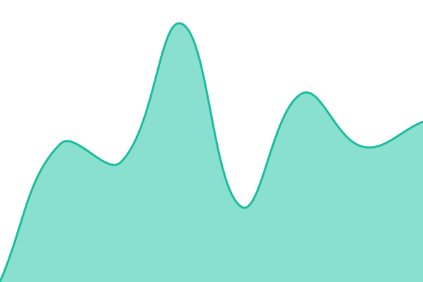

# [📈 Live Status](https://ashutoshsao.github.io/status): <!--live status--> **🟩 All systems operational**

This repository contains the open-source uptime monitor and status page for [ashutoshsao](https://ashutoshsao.github.io/status), powered by [Upptime](https://github.com/upptime/upptime).

With [Upptime](https://upptime.js.org), you can get your own unlimited and free uptime monitor and status page, powered entirely by a GitHub repository. We use [Issues](https://github.com/ashutoshsao/status/issues) as incident reports, [Actions](https://github.com/ashutoshsao/status/actions) as uptime monitors, and [Pages](https://ashutoshsao.github.io/status) for the status page.

<!--start: status pages-->
<!-- This summary is generated by Upptime (https://github.com/upptime/upptime) -->
<!-- Do not edit this manually, your changes will be overwritten -->
<!-- prettier-ignore -->
| URL | Status | History | Response Time | Uptime |
| --- | ------ | ------- | ------------- | ------ |
|  [Portfolio](https://ashutoshsao.com) | 🟩 Up | [portfolio.yml](https://github.com/ashutoshsao/status/commits/HEAD/history/portfolio.yml) | 

 320ms
     
 | 

<a href="https://ashutoshsao.github.io/status/history/portfolio">100.00%</a>
    

|  [Nebula](https://nebula.ashutoshsao.com) | 🟩 Up | [nebula.yml](https://github.com/ashutoshsao/status/commits/HEAD/history/nebula.yml) | 

 280ms
     
 | 

<a href="https://ashutoshsao.github.io/status/history/nebula">100.00%</a>
    

|  [Nebula WebSocket](https://ws.nebula.ashutoshsao.com) | 🟩 Up | [nebula-web-socket.yml](https://github.com/ashutoshsao/status/commits/HEAD/history/nebula-web-socket.yml) | 

 846ms
     
 | 

<a href="https://ashutoshsao.github.io/status/history/nebula-web-socket">100.00%</a>
    

|  [Nebula API](https://api.nebula.ashutoshsao.com/health) | 🟩 Up | [nebula-api.yml](https://github.com/ashutoshsao/status/commits/HEAD/history/nebula-api.yml) | 

 870ms
     
 | 

<a href="https://ashutoshsao.github.io/status/history/nebula-api">100.00%</a>
    

|  [Nebula workers](https://api.nebula.ashutoshsao.com/health/workers) | 🟩 Up | [nebula-workers.yml](https://github.com/ashutoshsao/status/commits/HEAD/history/nebula-workers.yml) | 

 901ms
     
 | 

<a href="https://ashutoshsao.github.io/status/history/nebula-workers">100.00%</a>
    

|  [Orin](https://orin.ashutoshsao.com) | 🟩 Up | [orin.yml](https://github.com/ashutoshsao/status/commits/HEAD/history/orin.yml) | 

 311ms
     
 | 

<a href="https://ashutoshsao.github.io/status/history/orin">100.00%</a>
    

|  [Orin API](https://api.orin.ashutoshsao.com/health) | 🟩 Up | [orin-api.yml](https://github.com/ashutoshsao/status/commits/HEAD/history/orin-api.yml) | 

 801ms
     
 | 

<a href="https://ashutoshsao.github.io/status/history/orin-api">100.00%</a>
    

|  [Ardin](https://ardin.ashutoshsao.com/signin) | 🟩 Up | [ardin.yml](https://github.com/ashutoshsao/status/commits/HEAD/history/ardin.yml) | 

 2976ms
     
 | 

<a href="https://ashutoshsao.github.io/status/history/ardin">100.00%</a>
    

|  [Ardin API](https://ardin.ashutoshsao.com/api/health) | 🟩 Up | [ardin-api.yml](https://github.com/ashutoshsao/status/commits/HEAD/history/ardin-api.yml) | 

 788ms
     
 | 

<a href="https://ashutoshsao.github.io/status/history/ardin-api">100.00%</a>
    

|  [Proxy](https://proxy.ashutoshsao.com/api/health) | 🟩 Up | [proxy.yml](https://github.com/ashutoshsao/status/commits/HEAD/history/proxy.yml) | 

 2026ms
     
 | 

<a href="https://ashutoshsao.github.io/status/history/proxy">100.00%</a>
    

<!--end: status pages-->

[**Visit our status website →**](https://ashutoshsao.github.io/status)

## 📄 License

- Powered by: [Upptime](https://github.com/upptime/upptime)
- Code: [MIT](./LICENSE) © [Anand Chowdhary](https://anandchowdhary.com)
- Data in the `./history` directory: [Open Database License](https://opendatacommons.org/licenses/odbl/1-0/)
